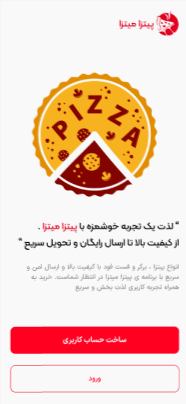
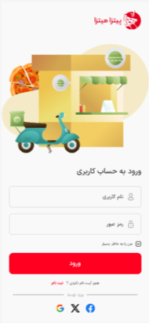
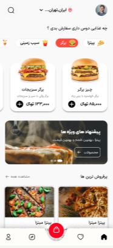
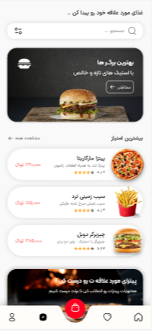
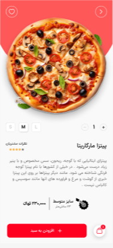
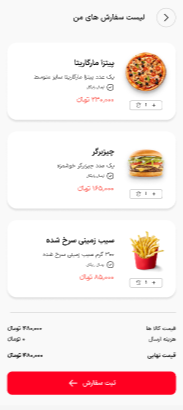
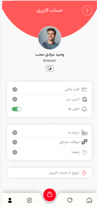

<p align="center">
  
</p>

<p align="center">
  
  
  
  
  
</p>

<h1 align="center">Pitza Mitza — Pizza & Fast-Food Ordering</h1>

<p align="center">
  A vibrant, Persian-first food ordering app: <b>pizza, burgers & fries</b> from craving to checkout.<br/>
  Smooth onboarding, menu discovery, customization and cart — built with Flutter + GetX.
</p>

<p align="center">
  <a href="#-visual-tour-real-app-captures"><b>Visual Tour</b></a> •
  <a href="#-features">Features</a> •
  <a href="#-tech-stack">Tech Stack</a> •
  <a href="#-run-locally">Run Locally</a>
</p>

---

## ✨ Visual Tour — Real App Captures

> **7 actual Flutter screens** — warm red-yellow brand, RTL, and buttery navigation. No mockups.

<p align="center">
  
  
  
  
</p>
<p align="center">
  
  
  
</p>

<p align="center"><sub>Top: Onboarding (“لذت یک تجربه خوشمزه”) → Login (اسکوتر) → Home (چه غذایی دوست داری؟) → Menu • Bottom: Pizza detail (S/M/L) → Cart (۳ آیتم) → Profile</sub></p>

<details>
<summary><b>📸 What you see</b></summary>
<br>

* **Onboarding (`onboarding.jpg`):** Seal `PIZZA` + pizza slice, copy `لذت یک تجربه خوشمزه با پیتزا میتزا` + `ساخت حساب کاربری` (red CTA) + `ورود`.
* **Login (`login.jpg`):** `ورود به حساب کاربری` with teal scooter & shop, fields `نام کاربری` / `رمز عبور` + `ورود` + Google/X/Facebook icons + `حساب کاربری ندارید؟ ساخت حساب`.
* **Home (`home.jpg`):** Greeting header + avatar, search `چه غذایی دوست داری سفارش بدی؟`, chips `پیتزا / برگر / سیب زمینی`, cards `برگر مخصوص ۱۳۳,۰۰۰ تومان` + `پیشنهاد های ویژه ها` carousel (بارتاپ) + `پرفروش ترین ها` grid.
* **Menu (`menu.jpg`):** `بهترین برگرها با اسپک منو و جنسی` hero + `پیشنهادی امروز` (`پیتزا مارگاریتا ★★★★ ۵۹,۰۰۰`), `سیب زمینی تند` / `چیزدبرگر دوبل` cards + bottom nav.
* **Detail (`detail.jpg`):** Full pizza `پیتزا مارگاریتا` (pepperoni-style), size `S M L`, quantity stepper `1`, ingredients, price `۲۳۰,۰۰۰ تومان` + `+ افزودن به سبد خرید` red CTA + cart badge.
* **Cart (`cart.jpg`):** `لیست سفارشی های من` with 3 rows: `پیتزا مارگاریتا ۲۳۰,۰۰۰`, `چیزرگر ۱۸۵,۰۰۰`, `سیب زمینی سرخ شده ۸۵,۰۰۰` + +/− steppers + `ثبت سفارش` CTA + footer `قیمت کل / هزینه ارسال / قیمت نهایی`.
* **Profile (`profile.jpg`):** `حساب کاربری` — `وحید مبارک محب @97net7`, avatar check badge, cards `کارت بانکی` / `آدرس من` (toggle) / `اعلان ها` + `ایجاد ها` / `پیشنهاد دوستان` / `زمان فعال` / `خروج از حساب کاربری`.

</details>

---

## 🚀 Features

- **Onboarding & Auth** — Branded `PIZZA` seal splash + phone/account creation (`ساخت حساب کاربری`), `نام کاربری` / `رمز عبور` + social logins, GetStorage session
- **Home Discovery** — Category chips (پیتزا / برگر / سیب زمینی), horizontal `پرفروش ترین ها` + `پیشنهاد های ویژه` carousel (`carousel_slider`)
- **Menu & Search** — Best burgers hero, `پیشنهادی امروز` cards with ★ rating, smooth_page_indicator
- **Product Detail** — Size selector S/M/L, quantity stepper, ingredients, `۲۳۰,۰۰۰ تومان` + add-to-cart with badge update
- **Cart** — `لیست سفارشی های من` with line items, +/−, price aggregation, `ثبت سفارش` bottom CTA
- **Profile** — Personal card + `کارت بانکی`, `آدرس من`, `اعلان ها` toggles, `خروج` flow
- **Persian UX** — `Locale('fa')`, RTL, Toman, `iconly` / `flutter_hicons` icons, red-cream palette

## 🧱 Tech Stack

| Area | Stack |
|------|-------|
| **Core** | Flutter 3.2+ / Dart |
| **State & Storage** | GetX 4.6.6 + GetStorage 2.1.1 |
| **Networking** | `dio` 5.4.0 |
| **UI** | `flutter_svg` 2.0.9, `flutter_spinkit` 5.2.0, `carousel_slider` 4.2.1, `smooth_page_indicator` 1.1.0, `iconly` 1.0.1, `flutter_hicons` 0.1.0 |
| **Codegen** | `build_runner` + `flutter_gen_runner` |

## 📂 Structure

```
lib/
├── constants/app_color.dart
├── splash_screen.dart
├── view/                    # onboarding, login, home, menu, detail, cart, profile
├── controller/              # GetX (cart, product, auth)
├── gen/                     # generated assets
└── main.dart                # GetStorage.init() → GetMaterialApp(Locale('fa'))
```

## ▶️ Run Locally

```bash
git clone https://github.com/Muhammad1831/pitza-mitza.git
cd pitza-mitza
flutter pub get
flutter pub run build_runner build --delete-conflicting-outputs
flutter run -d chrome    # web
flutter run -d android
```

## 🎨 Design Notes

- **Palette:** Pitza red `#E63946` + warm cream + teal scooter accent — appetizing & energetic
- **Typography:** Bold `PITZA` badge, rounded Persian body, clear price hierarchy
- **States:** Every list has loading / empty / error — no blank screens

## 🔜 Roadmap

- [ ] Payment + address map (flutter_osm)
- [ ] Push for order status (Firebase Messaging)
- [ ] Favorites with Hive

---

<p align="center">Built with Flutter 💙 by <a href="https://github.com/Muhammad1831">Muhammad Saleh</a> · Persian-first, crave-ready</p>
<p align="center"><sub>7 actual implementation captures — no Figma mockups. Brand “پیتزا میتزا” preserved.</sub></p>
